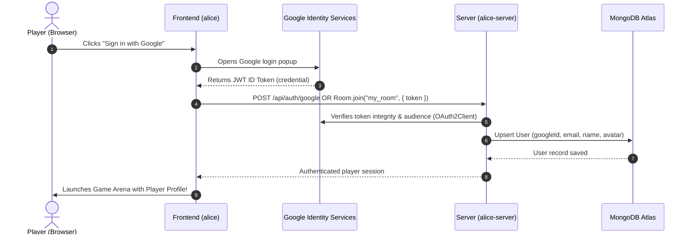

# 🔐 Google (Gmail) OAuth Login Setup Guide

This guide walks you through setting up Google Sign-In for both the **Frontend** (`alice`) and the **Backend Game Server** (`alice-server`), including MongoDB Atlas user persistence.

---

## 1. Get Google OAuth Client ID

1. Open the [Google Cloud Console](https://console.cloud.google.com/).
2. Select your project or click **New Project** (e.g. `Alice-Multiplayer`).
3. **Configure OAuth Consent Screen**:
   - Go to **APIs & Services** > **OAuth consent screen**.
   - Choose **External** and click **Create**.
   - Fill in:
     - **App name**: `Alice Multiplayer`
     - **User support email**: your Gmail address.
     - **Developer contact information**: your email.
   - Click **Save and Continue**.
   - In **Scopes**, ensure `email`, `profile`, and `openid` are selected.
   - In **Test users**, add your own Gmail address (necessary while the app status is "Testing").
   - Click **Save and Continue**.
4. **Create OAuth Client ID**:
   - Go to **APIs & Services** > **Credentials**.
   - Click **Create Credentials** > **OAuth client ID**.
   - Application type: **Web application**.
   - Name: `Alice Web Client`.
   - Under **Authorized JavaScript origins**, click **+ Add URI** and enter:
     - `http://localhost:5173` (Vite Frontend)
     - `http://localhost`
   - Under **Authorized redirect URIs** (optional for GIS button):
     - `http://localhost:5173`
   - Click **Create**.
5. Copy your **Client ID** (looks like `xxxxxxxxxxxx-xxxxxxxxxxxxxxxx.apps.googleusercontent.com`).

---

## 2. Configure Environment Variables

### Backend (`g:\alice-server\.env`)
Add your Client ID to `GOOGLE_CLIENT_ID`:
```env
PORT=2567
GOOGLE_CLIENT_ID=xxxxxxxxxxxx-xxxxxxxxxxxxxxxx.apps.googleusercontent.com
NODE_ENV=development

# MongoDB Atlas
MONGODB_URI=mongodb+srv://<username>:<password>@alice.eklnctn.mongodb.net/alice?retryWrites=true&w=majority
```

### Frontend (`g:\alice\.env`)
Add the same Client ID to your frontend `.env`:
```env
VITE_GAME_SERVER_URL=http://localhost:2567
VITE_GOOGLE_CLIENT_ID=xxxxxxxxxxxx-xxxxxxxxxxxxxxxx.apps.googleusercontent.com
```

---

## 3. How the Authentication Works End-to-End



---

## 4. Testing the Setup

1. **Start the backend**:
   ```bash
   cd g:\alice-server
   npm start
   ```
2. **Start the frontend**:
   ```bash
   cd g:\alice
   npm run dev
   ```
3. Open `http://localhost:5173` in your browser.
4. Click the Google Sign-In button and log in with your Gmail account.
5. Your user will be verified and saved in MongoDB Atlas under the `users` collection!

---

## 5. Troubleshooting Common Issues

| Issue | Cause | Fix |
|---|---|---|
| `origin_mismatch` or `idpiframe_initialization_failed` | Origin not added to Google Cloud Console | Add `http://localhost:5173` to **Authorized JavaScript origins** in Google Cloud Console. |
| `Access blocked: This app has not been verified` | App is in Testing mode | Add your Gmail account to **Test Users** under OAuth consent screen. |
| `querySrv ECONNREFUSED` | Atlas IP whitelist or DNS SRV resolution | 1. Go to MongoDB Atlas > **Network Access** > **Add IP Address** > Choose **Allow Access From Anywhere (`0.0.0.0/0`)**.<br>2. Or use standard non-SRV connection string. |
